# 重生之我用系统搓游戏

Qoder 高校创造力大赛作品

本项目基于开源项目 [petalwake](https://github.com/lorenchilll961-debug/petalwake)（MIT 协议）二次开发。目前的二次开发内容：**全量中文本地化**——界面、提示、地名与世界观数据；后续计划融入二十四节气世界规则与外卖配送玩法。

---

# 花信风（Petalwake）

*一柄扫帚，一座岛，一阵好风。*

花信风是一款浏览器小游戏：骑上魔法扫帚，低空掠过花海、海崖与开阔海面，看身后的空气留下怎样的痕迹。扫帚会拖出一对模拟的尾流涡，整个世界都会回应它——花瓣被卷起随行，草叶伏倒，海面撕出浪沫，而你飞得越快，掠过的花剩下的花瓣就越少。

岛上有人烟。南岸的**云雀港**是一座约百栋手工建模建筑的港口小镇；北崖上是**石冢崖**村；绿野间散布着农庄、磨坊与信标。四分之一的建筑有一处高高的落脚点——塔顶回廊、屋顶露台、灯塔步道。降落其上，送出身上的包裹，再接起下一件。

**在线游玩：<https://petalwake.non.io/v2>**（需支持 WebGL2 的桌面浏览器，首次加载约 95 MB）。
未加入城镇的旧版本仍在 <https://petalwake.non.io>。

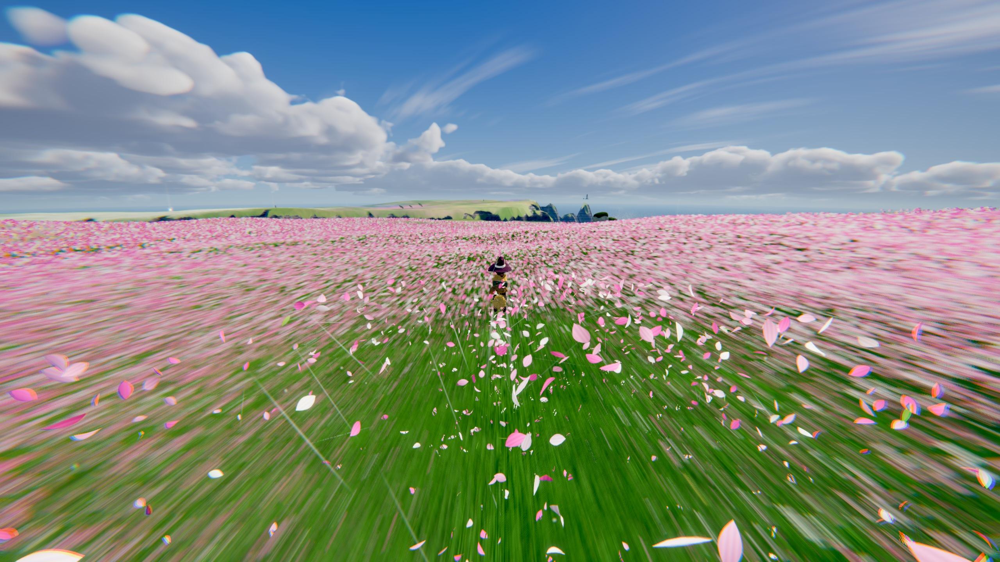

<p>
  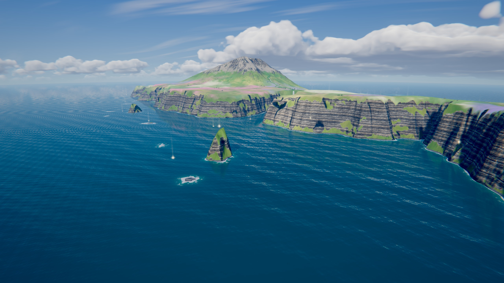
  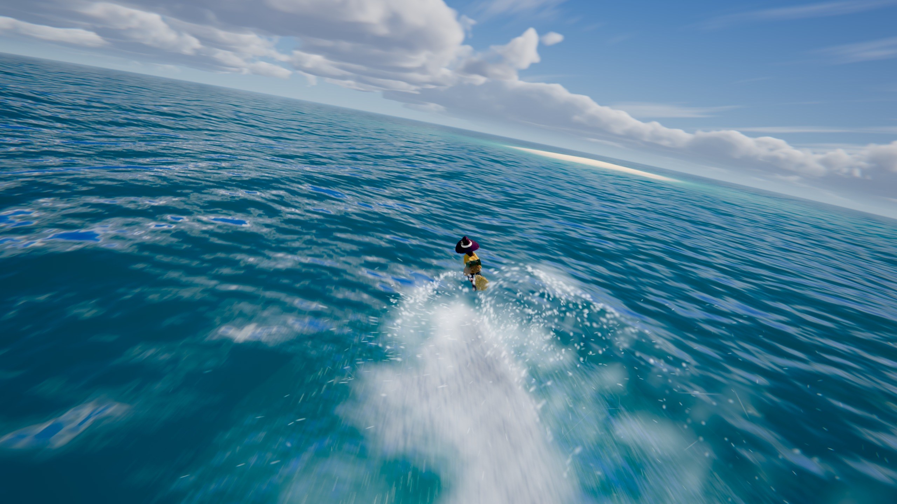
  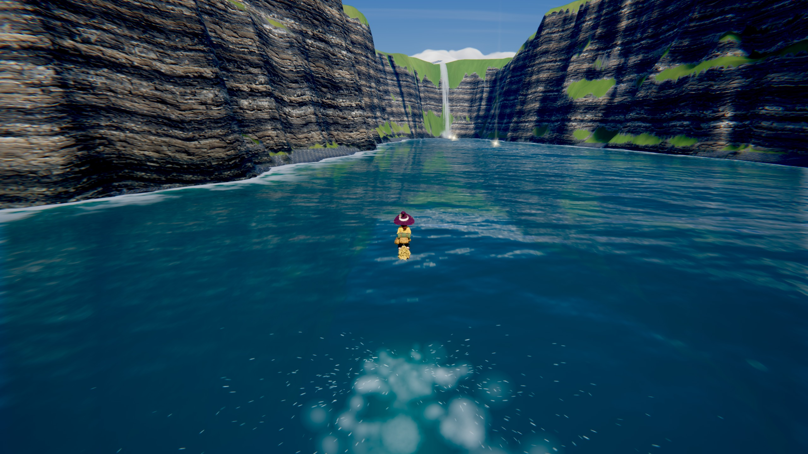
  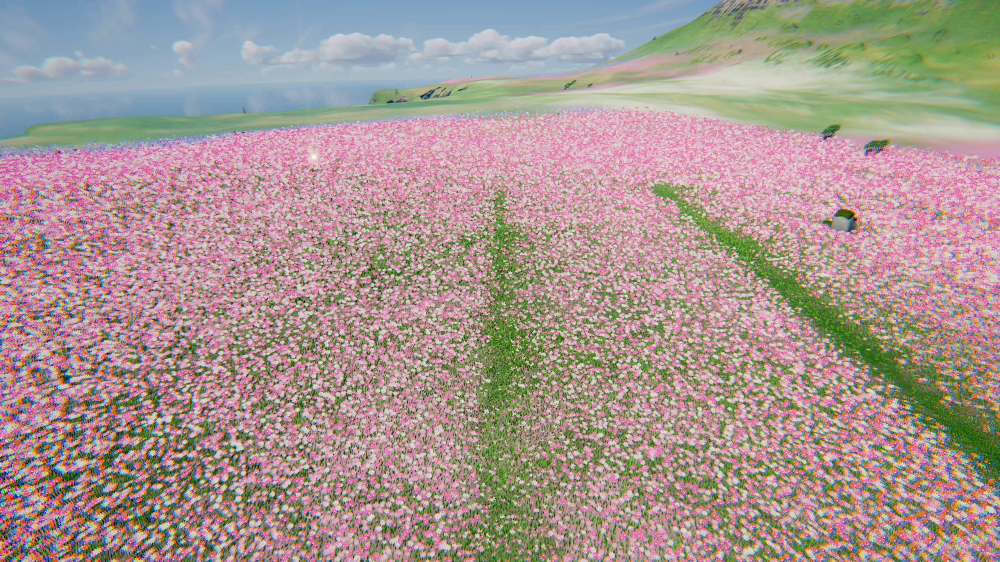
  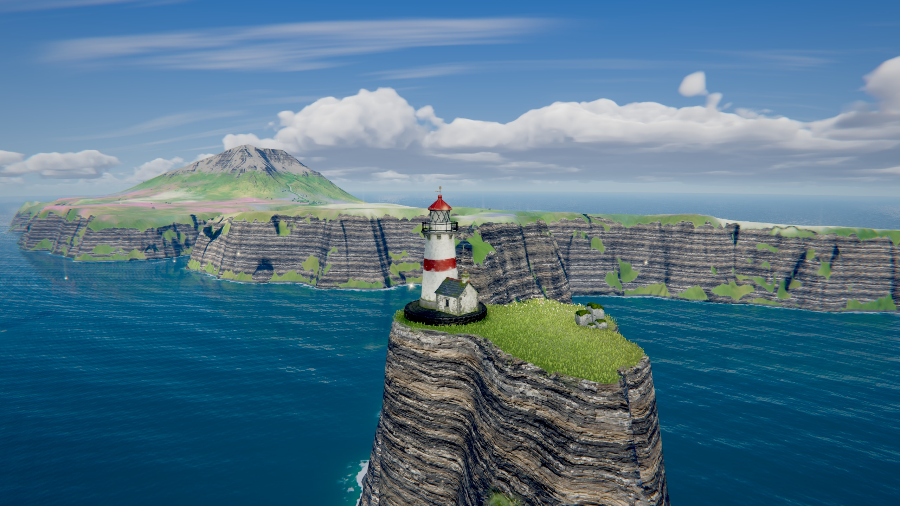
  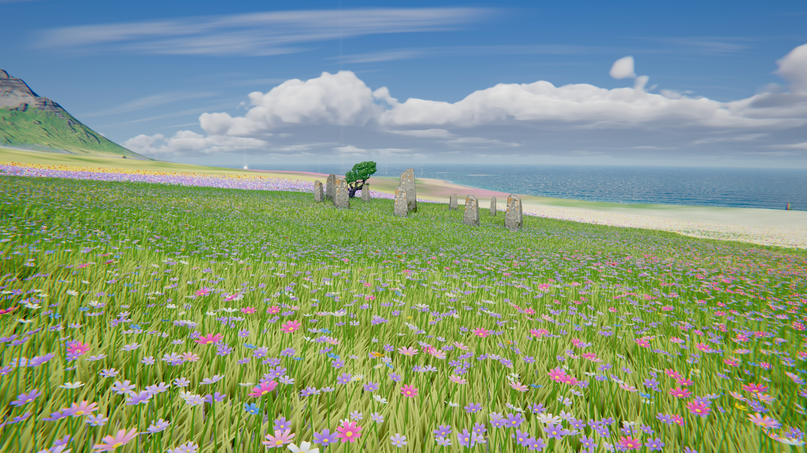
</p>

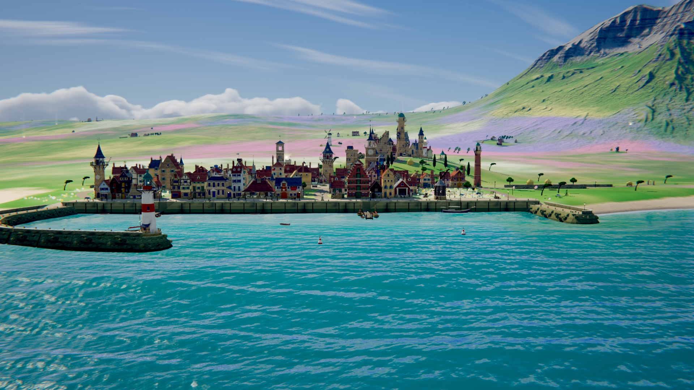

<p>
  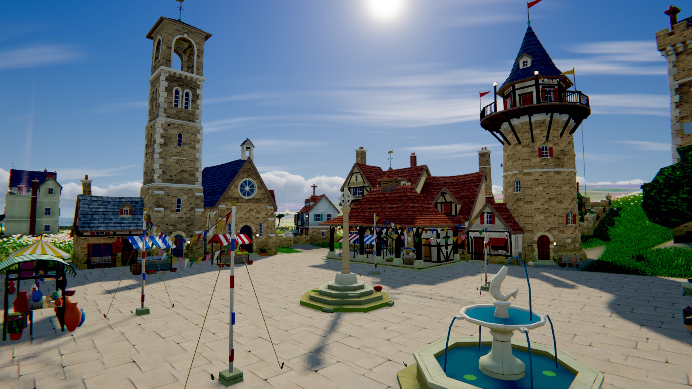
  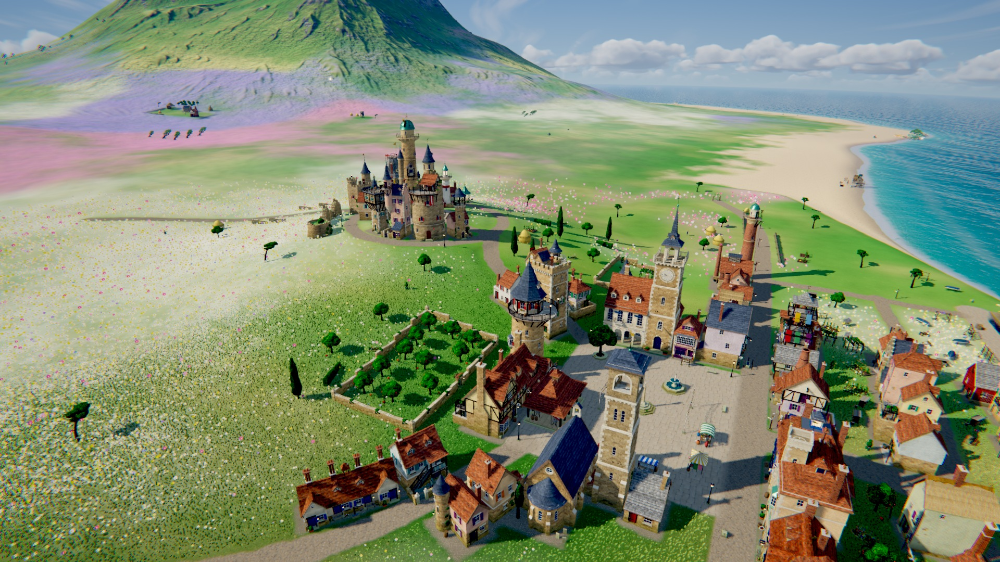
  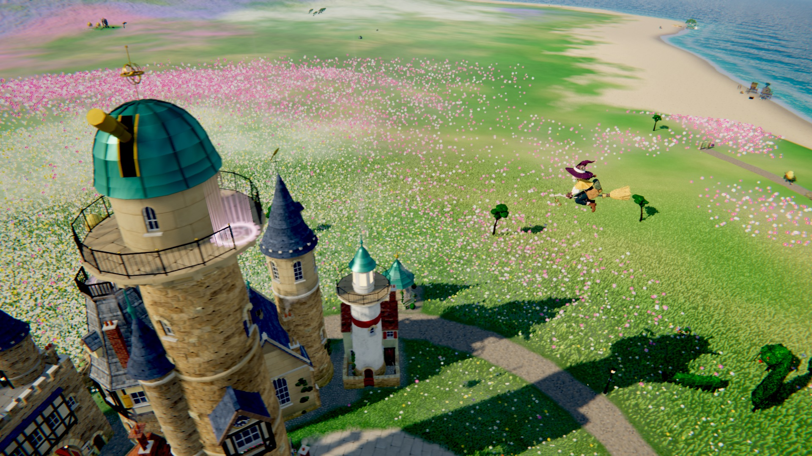
  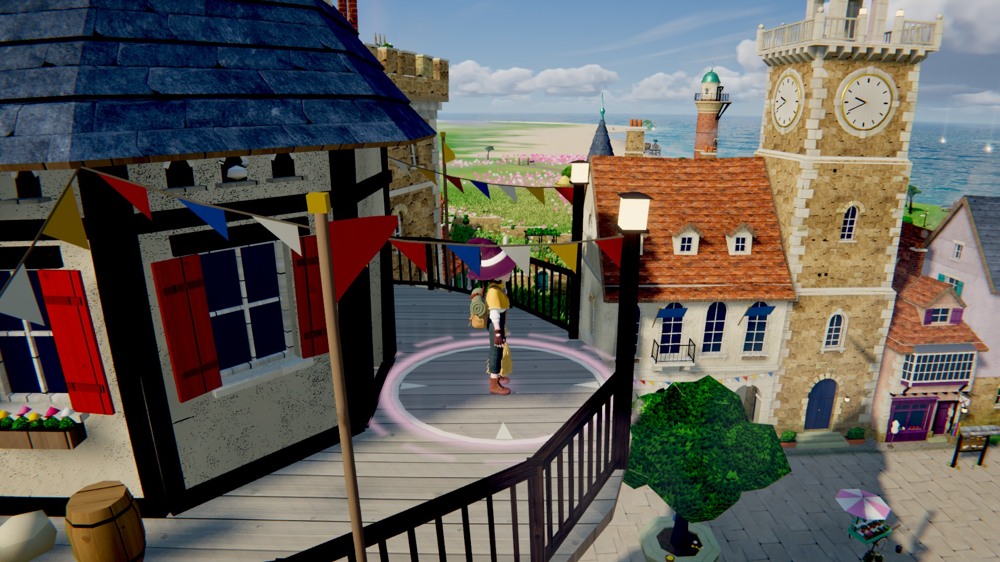
  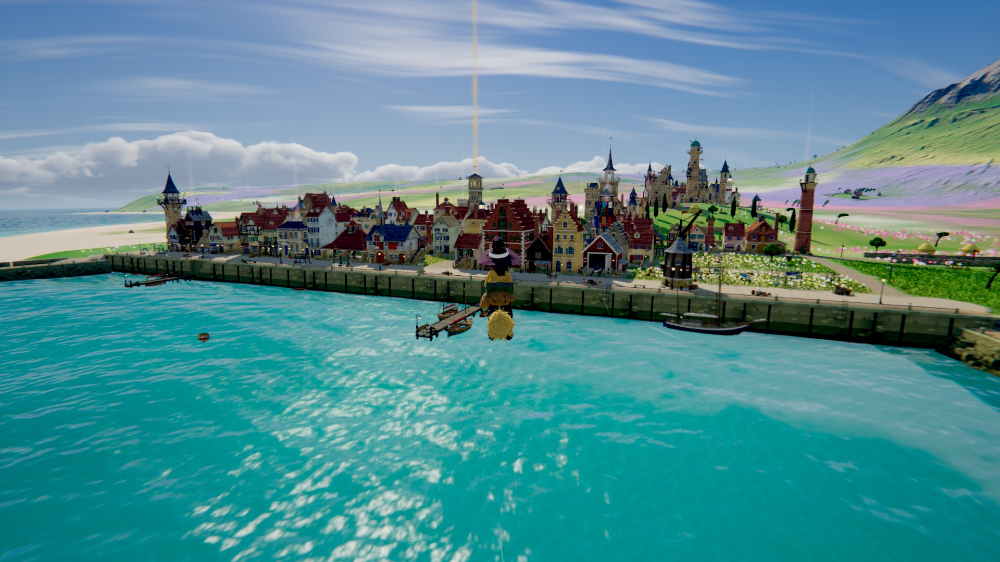
  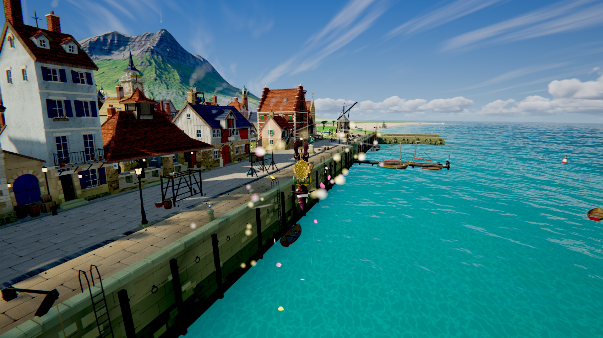
  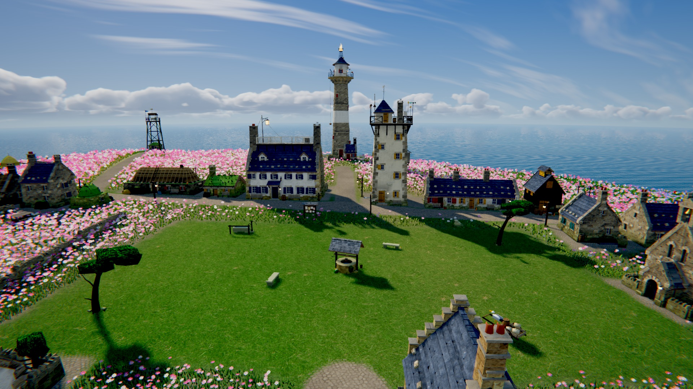
  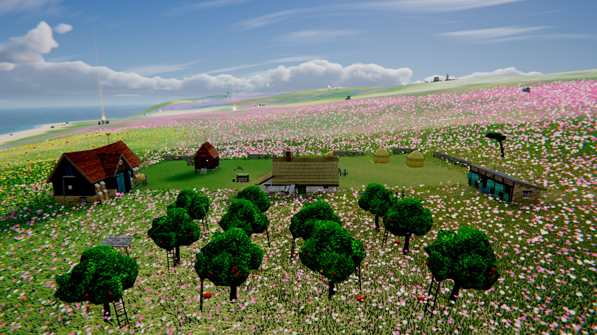
  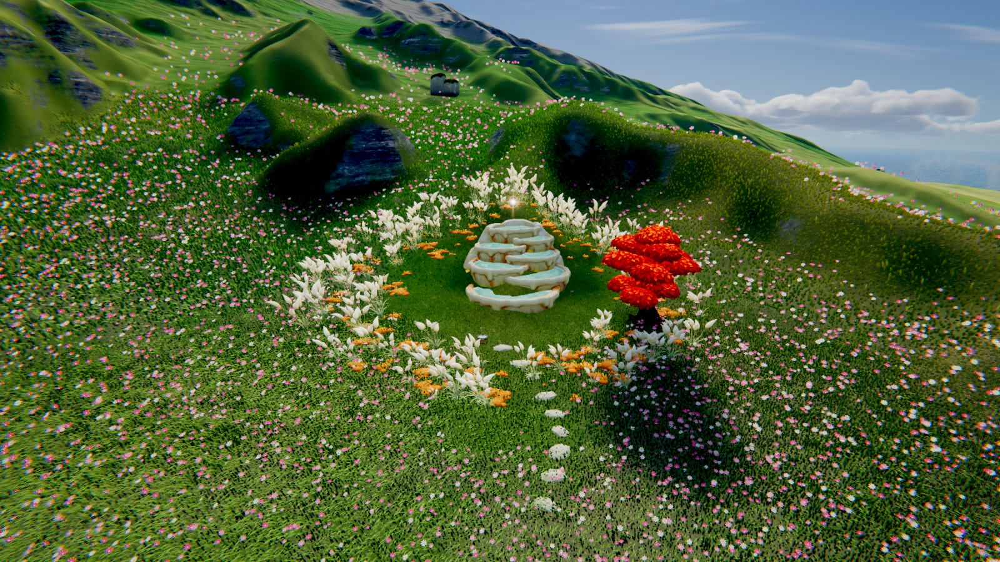
  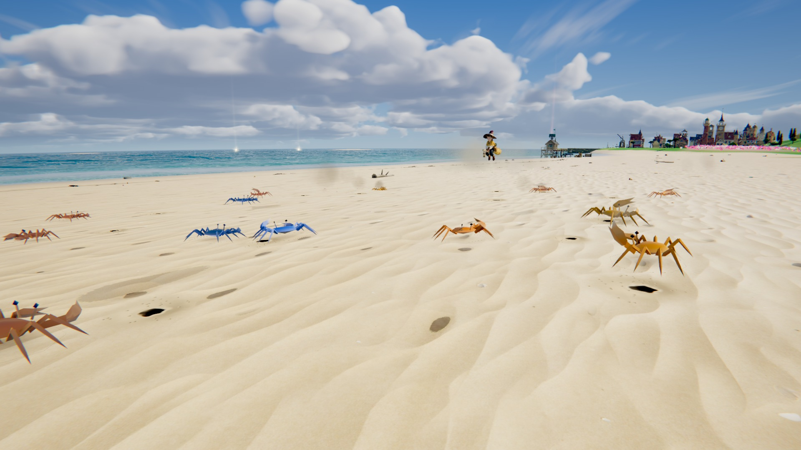
</p>

## 操作

| | |
|---|---|
| <kbd>W</kbd> <kbd>S</kbd> 或 <kbd>↑</kbd> <kbd>↓</kbd> | 俯冲 / 爬升 |
| <kbd>A</kbd> <kbd>D</kbd> 或 <kbd>←</kbd> <kbd>→</kbd> | 侧倾转向 |
| <kbd>Shift</kbd> | 驭风疾行（加速） |
| <kbd>Space</kbd> | 收势缓行（刹车） |
| <kbd>Space</kbd> <kbd>Space</kbd> | 降落点附近亮起时落地；再按 <kbd>Space</kbd> 起飞 |
| <kbd>Q</kbd> | 凌空翻身（集齐十枚风之籽后解锁） |
| <kbd>J</kbd> | 驭风者的手记（珍藏图鉴） |
| 鼠标 | 点击画面后用鼠标转向；左键加速，右键刹车 |
| <kbd>C</kbd> | 视角：追随 / 贴地 / 远眺 |
| <kbd>I</kbd> | 反转俯仰 |
| <kbd>P</kbd> | 隐藏界面 |
| <kbd>M</kbd> | 静音 |
| 手柄 | 左摇杆转向，右扳机或 A 加速，左扳机或 B 刹车 |

游戏没有失败一说。俯冲会自己改出并弹跳落地，撞墙只会被推开，飘向远海自会有风把你送回家。发光的风之籽散布在岛上最好的飞行线上，接住一枚就能补充风势。

岛上永远有一件包裹等着送出：收件塔楼上立着金光，罗盘指路——有时只是镇上一跃之遥，有时要飞到岛的另一头。海岸与丘陵间还藏着十二处各有风物的隐秘之地，每处有一件珍藏待寻；手记里留着未寻之处的线索。退潮的滩涂上，岩石结着藤壶，螃蟹见你来了就跑。

## 本地运行

无构建步骤，页面直接从 `src/` 加载 ES 模块：

```bash
python3 tools/serve.py
```

然后打开 <http://localhost:6280>。任意静态文件服务器皆可（必须以 HTTP 提供，直接双击打开 `index.html` 无法加载模块）。

URL 参数：`?q=low|medium|high` 设草甸密度，`?dpr=1.5` 设像素比，`?noscale` 关闭自动分辨率缩放，`?play` 跳过标题屏。

仅在 Chrome 下开发与验证。

## 架构一览

全部为原生 JavaScript + [three.js](https://threejs.org) r187（WebGL2），几乎所有视觉都出自自定义 shader：

- **尾流**（`src/fx/vortex.js`）：扫帚身后铺开一圈 256 个截面，各携带一对反向旋转的涡核；涡核互相驱动并与地面镜像耦合，于是这一对涡会下沉、沿地面向两侧跑开；随时间变胖变弱，随风漂移，并以非定常方式脱落。粒子（花瓣、叶片、浪沫、砂砾）在 CPU 上采样涡场（`src/fx/particles.js`、`src/fx/windfx.js`）；同一尾迹还会画成两幅自上而下的贴图——草、花、树、水读取它来倾倒、翻涌、起沫（`src/fx/wake.js`），以及一幅全岛范围的「花瓣流失图」（`src/fx/strip.js`）。
- **草甸**（`src/world/meadow.js`）：草与花在 GPU 上围绕相机实时放置；花连成一片随距离按层级稀疏的整场，花瓣随流失图一片片掉落。
- **岛屿**（`src/world/terrain.js`、`tools/terrain/bake.py`）：6 km 见方、4096 采样每边的高度场，离线烘焙：成层海崖、峡湾、雨滴侵蚀、一条河与瀑布、花海漂移，以及光照与阴影图。以 CDLOD 四叉树绘制，配随机化纹理采样隐藏平铺。
- **海、河、天空**（`src/world/water.js`、`src/world/river.js`、`src/world/clouds.js`）：Gerstner 涌浪带岸浪与反射；光线步进的云在加载时烘焙进天空贴图。
- **城镇**（`src/world/town.js`、`tools/town`）：每栋建筑都是一个短 Python 脚本，在 Blender 里用一套小零件（带真实开洞的墙、错缝砌筑的屋顶、回廊、烟囱、招牌）建模，见 `tools/town/README.md`。布局脚本沿手工绘制的街道排布，地形随之为其挖填（码头、港池、防波堤），最后打包为量化分块、三级细节、每城一张烘焙日光阴影图与一张碰撞高度网格。
- **差事**（`src/game`）：降落点、进场与落地、包裹投递、凌空翻身。
- **隐秘之地与滩涂生灵**（`src/world/places.js`、`src/world/shore.js`）：十二处各有装扮与珍藏的地点；海岸上的藤壶、海藻与螃蟹。
- **飞行与相机**（`src/player/flight.js`、`src/player/camera.js`）：为低空掠行调校的街机式模型；追逐相机随减速贴近、随冲刺拉远。
- **画面管线**（`src/core/pipeline.js`）：HDR + MSAA、相机运动模糊（骑手与粒子在其上保持清晰）、bloom、体积光、镜头光斑与色调映射。
- **声音**（`src/audio/audio.js`）：全部在浏览器中合成，无音频文件。

```
index.html          页面、标题屏与 HUD
src/                游戏本体
  core/             共享 uniform、画面管线
  world/            地形、草甸、海、河、天空、云、静物、风之籽、城镇、隐秘之地、滩涂
  player/           飞行模型、相机、输入、骑手
  game/             降落、投递、凌空翻身
  ui/               手记（图鉴）
  fx/               尾流涡、尾流贴图、粒子、风的效果
  shaders/          所有材质共用的 GLSL
  audio/            程序化声音
assets/             游戏加载的资源：烘焙地形、模型、贴图
vendor/three/       three.js r187，自 npm 包原样复制
tools/
  serve.py          开发服务器（无缓存、可截帧）
  terrain/bake.py   生成 assets/terrain 下的一切
  town/             建筑套件、一楼一脚本、布局、地形适配、打包
  shore/            生成贝壳、海藻、巨石与螃蟹的小套件
  places/           隐秘之地的布置
  gen/              概念图、模型与材质（fal / Meshy 生成）
  blender/          将生成网格加工为游戏资产
screenshots/
```

## 重建岛屿

世界定义在 `tools/terrain/bake.py`；要改世界，改这里，别改游戏。

```bash
python3 -m venv tools/.venv
tools/.venv/bin/pip install -r tools/requirements.txt
tools/.venv/bin/python tools/terrain/bake.py 4096 --keep-props
```

一次烘焙约一分钟。`--keep-props` 让树、立石与巨石留在原地；不加则重新撒布。

## 重建城镇

建筑与街景由 `tools/town/buildings`、`tools/town/props` 中的脚本在 Blender（5.2）里建模：

```bash
/Applications/Blender.app/Contents/MacOS/Blender -b -P tools/town/make.py -- h_inn --render --blend
```

这会把游戏用的网格写进 `art/town/build`，并输出预览图与可打开的 `.blend`。`tools/town/layout.py` 决定一切立在何处。改完两者之一后：

```bash
tools/town/build.sh
```

规划地块、适配地形并打包 `assets/town`。`MODELS=1 tools/town/build.sh` 会先让每个建筑脚本过一遍 Blender（数分钟），新克隆的仓库需要跑一次，因为 `art/` 不在仓库里。地形适配永远从未动过的岛屿烘焙（存于 `art/terrain_base`）出发；新克隆请先按上文烘焙岛屿。

## 重新生成美术素材

骑手、树木立石与隐秘之地的部件并非手工建模：概念图来自 fal（`nano-banana-pro`），网格来自 Meshy（`meshy-7.1`，图生 3D），地面与岩石材质来自 fal（`patina`），再由 Blender 脚本清理、按风加权并导出。`tools/gen` 中的脚本从环境变量读取 `FAL_KEY` 与 `MESHY_API_KEY`。它们的原始产物写入不在仓库中的 `art/`（约 250 MB）；加工后的成果在 `assets/`。

## 版本记录

| 版本 | 内容 |
|---|---|
| v0.1.0 | 接入中文字体（霞鹜文楷替换 Fraunces/Karla） |
| v0.2.0 | 标题屏与 HUD 界面汉化 |
| v0.3.0 | 加载提示、toast、地区地名与配送文案汉化 |
| v0.4.0 | 城镇、降落点、隐秘之地与珍藏数据汉化 |

## 许可与致谢

本项目以 MIT 协议发布，见 [LICENSE](LICENSE)。

- 基于 [petalwake](https://github.com/lorenchilll961-debug/petalwake) 二次开发，原项目以 MIT 协议开源，感谢原作者 Jacob。
- [three.js](https://threejs.org) r187，MIT，见 [vendor/three/LICENSE](vendor/three/LICENSE)；内嵌 meshoptimizer 解码器（MIT，Arseny Kapoulkine）。
- 中文界面字体 [霞鹜文楷 LXGW WenKai](https://github.com/lxgw/LxgwWenKai)，SIL Open Font License 1.1。
- 模型与材质由 [Meshy](https://www.meshy.ai) 与 [fal](https://fal.ai) 生成（原项目生成，随项目继承）。

## 它是怎么做出来的

原项目 petalwake 由 [Claude Code](https://claude.com/claude-code) 在一天内从一个简短的需求与一段定调参考视频构建而成，随后按几轮试玩笔记调校；次日加入城镇、投递、隐秘之地与滩涂生灵，建筑由若干两两协作的辅助代理建模。代码、shader、地形烘焙与资产管线由模型编写；美术由上述服务生成（建筑除外，它们以代码建模）。本项目在其开源基础上继续演进。
