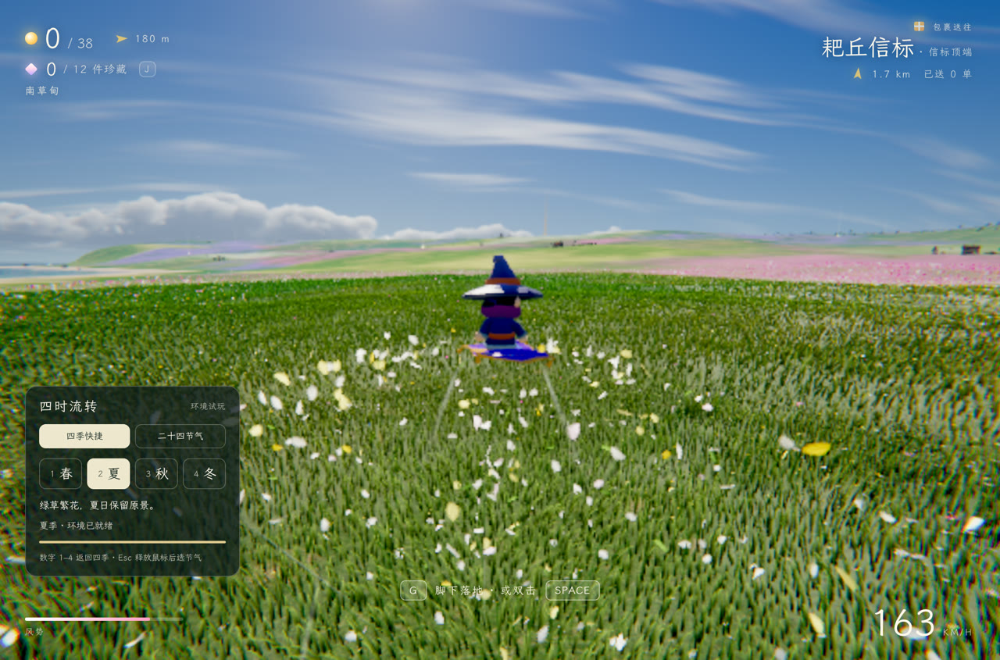
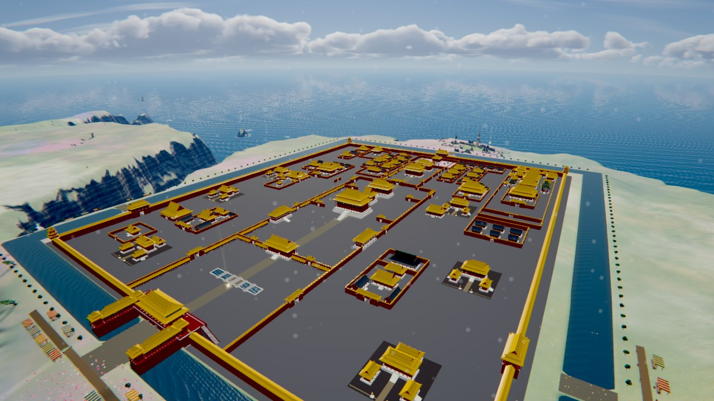
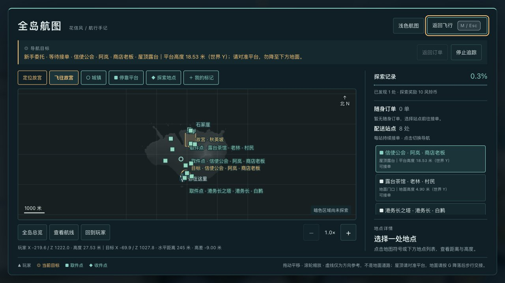

# 花信风

**骑上魔毯，穿过二十四节气，在云雀港送信、飞越秋英坡故宫，追踪两条赤脊巨龙。**

《花信风》是面向桌面浏览器的中文海岛探索游戏，也是 Qoder 高校创造力大赛作品。你可以从海面飞到城镇屋顶，落地后步行、奔跑或跳跃，在街巷和宫院之间自由探索。第一份委托从云雀港信使公会出发，把春茶送到露台茶馆。

## 岛上能做什么

| 特色 | 实机截图 |
| --- | --- |
| **魔毯飞行与自由落地** · 借风掠过草甸、海崖和城镇。选好落点后可步行、跳跃，再骑上魔毯。 |  |
| **秋英坡故宫** · 漫游中轴、六组配院和宫外市集。护城河有流动水纹，宫殿窗格和市集灯笼会在入暮后亮起。 |  |
| **双龙与可重建工坊** · 两条赤脊巨龙在岛内独立换线、轮流俯冲喷火。工坊受击后屋顶、墙体碎裂，残骸约 8 秒后开始自行重组。 |  |
| **街巷信使与居民** · 和 NPC 交谈，在八个站点接单，同时携带多单，并在同站批量交付。 |  |
| **航图与二十四节气** · 探索地形、标记地点和追踪配送路线。可切换节气、昼夜和天气，航图与配送进度会随存档保留。 |  |

## 开始游戏

需要 **Python 3** 和支持 **WebGL2** 的现代桌面浏览器。运行游戏无需安装 npm 依赖。

```bash
python3 tools/serve.py 6280
```

打开 [localhost:6280](http://localhost:6280)，等岛屿加载完后点击「乘风而起」。如果画面吃力，可用 [低画质入口](http://localhost:6280/?q=low&dpr=1)。

按 **M** 打开航图。选择「定位故宫」查看宫城位置，选择「飞往故宫」抵达午门广场上空。午门广场、太和门前广场和东观景台都有金光落点，在落点附近双击空格可请求降落。

追踪「秋英坡守望工坊」可找到巨龙活动区。可用 [巨龙演示入口](http://localhost:6280/?dragon&q=low&dpr=1) 观看巡航、喷火与重建。

### 先送完第一单

1. 按 **M** 打开航图，追踪信使公会。
2. 飞到公会屋顶平台附近，双击 **Space** 请求降落。
3. 落稳后走近阿岚，按 **E**，选择「接下这单 · 送往露台茶馆」。
4. 按 **G** 起飞，跟着航图飞到露台茶馆门前的地面标记，在标记上方按 **G** 降落。
5. 落稳后走近老林，按 **E** 确认交货。同一站点的多单可以一起结算。

### 常用操作

| 按键 | 飞行中 | 地面上 |
| --- | --- | --- |
| W / A / S / D | 俯仰与转向 | 移动 |
| Shift | 加速 | 奔跑 |
| Space | 按住减速，双击请求降落 | 跳跃，可在空中调整方向 |
| G | 尝试在脚下降落 | 起飞，跳跃中也可使用 |
| E | — | 交谈、接单与交货 |
| C | 切换四种飞行视角 | — |
| M / J | 航图 / 探索手记 | 航图 / 探索手记 |
| Esc | 释放鼠标或关闭界面 | 释放鼠标或关闭界面 |

## 开发与测试

项目使用原生 JavaScript、Three.js r187、WebGL2 和自定义 GLSL。渲染与世界状态在 `src/core/`，飞行和角色在 `src/player/`，任务与交互在 `src/game/`，环境变化在 `src/seasons/`，航图与界面在 `src/ui/`，双龙和工坊在 `src/dragon/`，宫城集成在 `src/world/palace.js`。

安装开发依赖后，使用 Node.js 24 或更新版本运行本地回归测试：

```bash
npm ci
node --test src/core/*.test.mjs src/game/*.test.mjs src/seasons/*.test.mjs src/ui/*.test.mjs src/world/*.test.mjs
```

全岛共有 8 个配送站点，地面和屋顶各 4 个。可以反复接单、同时携带多单，在航图中选择追踪的目的地。订单、奖励和探索进度保存在当前浏览器，换浏览器或访问地址后需要重新开始。世界素材的制作流程见 [城镇制作工具](tools/town/README.md)。

## 许可与素材署名

- 故宫的宫殿构件、程序化材质和布局数据来自陈华山、陈诺创作的 [故宫 3D 虚拟游览](https://github.com/watsonbkeel/forbidden-city-3d)，基准提交 [8de5c83](https://github.com/watsonbkeel/forbidden-city-3d/commit/8de5c83d25a669a014575a1489429f064a464496)，见随附的 [MIT 许可](vendor/forbidden-city/LICENSE)。宫城横向为模型尺寸的 56%，垂直为 64%。地基由岛屿自身地形渐变接入，覆盖护城河、四门、中轴、东西六宫、御花园、宁寿宫与外东、外西路，支持地面院落漫游。GLB 内景保留在上游项目。午门、太和门及太和殿的外观参照[故宫博物院午门](https://www.dpm.org.cn/explore/building/236454.html)、[太和门](https://www.dpm.org.cn/explore/building/236439.html)和[太和殿](https://www.dpm.org.cn/explore/building/236465.html)的建筑介绍。东观景台是为游戏设置的着陆设施。宫城密度与街区关系还参考了[卫星俯瞰图](https://www.thebeijinger.com/blog/2018/01/08/whats-name-why-it-called-forbidden-city)和 [Mozaik 的故宫 3D 复原](https://www.mozaweb.com/ja/Extra-3D-ZiJinCheng_BeiJing17ShiJi-415763)。
- 源码版权与许可见 [LICENSE](LICENSE)，渲染依赖许可见 [Three.js 许可](vendor/three/LICENSE)。
- 法师模型与动画来自 KayKit Adventurers，见 [模型许可](assets/models/characters/KayKit-LICENSE.txt)。
- 魔毯模型由 Anna M 创作，许可为 CC BY 3.0，见 [署名与修改记录](assets/models/vehicles/magic-carpet-LICENSE.txt)。
- 居民模型与动画来自 Quaternius，见 [素材记录](assets/models/npcs/SOURCES.txt) 与 [许可](assets/models/npcs/LICENSE-Quaternius.txt)。
- 中文字体使用[霞鹜文楷](https://github.com/lxgw/LxgwWenKai)，采用 SIL Open Font License 1.1。

### 巨龙系统参考

| 项目 | 兼容性与采用的机制 |
| --- | --- |
| [Dragonflight: Open World](https://github.com/ypengly/Dragonflight_Open_World) | 单页加载 Three.js r128。参考空中姿态和喷火粒子、动态光设计。 |
| [Dragon: Flight Playground](https://github.com/clyons/dragon-flight-til) | Three.js r186、Box3D WASM 0.2.0、Vite 8.3。参考样条导航和关节滞后。原模型翼固定，模型资产采用 CC BY-NC-SA 4.0。 |
| [three-pinata](https://github.com/dgreenheck/three-pinata) | Three.js peer 版本要求 ≥ r158。参考平面切割、封闭截面以及内外双材质，自行在 r187 上实现工坊构件的凸网格切割。 |

两条巨龙都使用原创参数化网格。双翼各有肩、肘、腕和五根翼指骨，推进、滑翔、俯冲和拉升共享同一套骨骼。破坏目前覆盖守望工坊。每条随机路线会检查岛内地表高度、翼尖净空和两龙间距。
