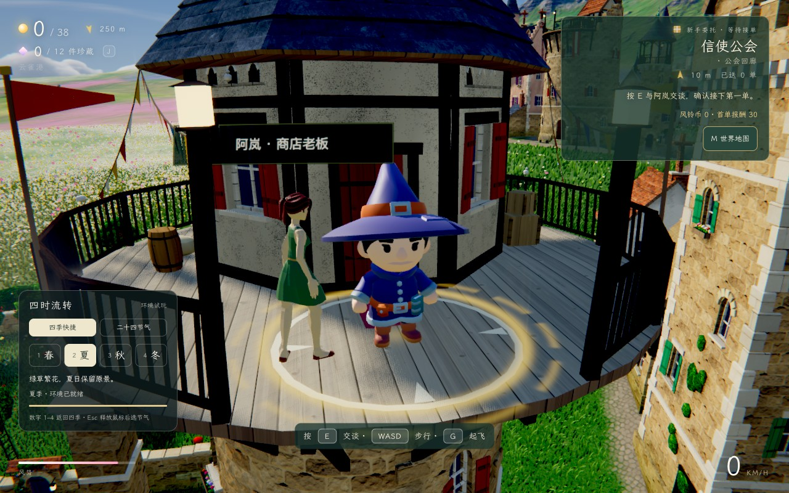

# 花信风

**一张魔毯，一座岛，二十四节气里的信使旅程。**

Qoder 高校创造力大赛作品「重生之我用系统搓游戏」。在浏览器里乘毯掠过花海与海崖，降落到港口的屋顶露台，走近居民接下一单春茶，再看看海岛如何随四时流转。



## 现在可以玩什么

- **二十四节气与四季切换**：春花、夏绿、秋色、冬季深黄枯草和积雪，配合风候、雨雪、雾与光照变化；面板提供节气、物候和农事介绍。
- **魔毯飞行**：可加速、减速、侧倾与爬升；宽约 1.90 米、长约 2.84 米的魔毯带有轻微浮动和边缘波浪。
- **同一个角色，上天也落地**：法师在飞行时端坐毯心，落地后支持第三人称步行、奔跑和跳跃，动画平滑切换；起降检查地形、建筑与净空。
- **有来有往的第一单**：到信使公会找商店老板阿岚，明确接单后，将春茶送到露台茶馆，走近老林确认交货，获得 30 枚风铃币并补满风势。
- **会活动的居民**：商店老板、茶馆村民与观星塔魔法师拥有骨骼动画、短程巡逻、朝向和近距离交互。
- **全岛航图与探索手记**：地图显示玩家、配送目标、建筑和平台高度；岛上还散布着风之籽与十二处珍藏。
- **四种飞行视角**：追随、贴地、远眺，以及带航向、速度、离地高度和目标指引的护目镜视角。落地自动使用第三人称镜头。
- **电脑端中文体验**：专注键盘与鼠标操作，不提供手机端、虚拟摇杆或屏幕触控按钮。

## 快速开始

需要 Python 3 和支持 WebGL2 的现代浏览器。游戏资源及 Three.js 已随仓库提供，**运行不需要 npm install，也没有打包步骤**。

```bash
python3 tools/serve.py 6280
```

打开 <http://localhost:6280>，等待资源与天空加载后点击「乘风而起」。也可以使用 `npm start`，它执行相同命令。必须通过 HTTP 访问，不能直接双击 HTML 文件。

性能较弱的设备可使用 <http://localhost:6280/?q=low&dpr=1>。首次加载包含较大的地形与模型资源；已跟踪的大文件显示字节进度，天空绘制等阶段另行显示进度。

| 参数 | 用途 |
|---|---|
| `q=low` / `medium` / `high` | 草甸密度 |
| `dpr=1` | 限制像素比，降低 GPU 负担 |
| `noscale` | 关闭自适应分辨率 |
| `play` | 跳过标题屏 |

本仓库暂未提供经验证的本版本公开试玩地址；本地运行的是包含节气、魔毯、步行和首单配送的整合版本。

## 操作说明

| 操作 | 飞行中 | 地面上 |
|---|---|---|
| W / S 或上下方向键 | 俯冲 / 爬升 | 前进 / 后退 |
| A / D 或左右方向键 | 侧倾转向 | 左右移动（相机方向） |
| Shift | 加速，消耗风势 | 奔跑 |
| Space | 按住减速，双击请求降落 | 跳跃 |
| G | 降落到脚下安全地面或屋顶 | 坐上魔毯起飞，需先落稳并留有净空 |
| 鼠标 | 点击场景后转向，左键加速、右键减速 | 点击场景后环顾 |
| E | — | 走近居民交谈、接单、确认交货 |
| C | 追随 → 贴地 → 远眺 → 护目镜 | 保持第三人称步行，选择的飞行视角在起飞后恢复 |
| M | 世界地图 | 世界地图 |
| J | 探索手记 | 探索手记 |
| 1–4 | 春 / 夏 / 秋 / 冬 | 春 / 夏 / 秋 / 冬 |
| N / P / I | 静音 / 隐藏界面 / 反转飞行俯仰 | 同左 |
| Q | 收集十枚风之籽后可凌空翻身 | — |
| Esc | 释放鼠标，关闭地图或对话 | 同左 |

地图也可通过任务卡按钮打开。电脑连接手柄时保留飞行轴向、加速、减速与翻身；完整地面交互使用键盘和鼠标。

## 第一单怎么完成

1. 按 M 打开航图，找到金色标记的**信使公会**。
2. 飞到目标附近，双击 Space 降落到平台，而不是楼下街道。
3. 落稳后走近阿岚，按 E，再选择「接下春茶订单」。
4. 按 G 起飞，用航图确认**露台茶馆**的位置与屋顶高度。
5. 飞行一段距离后抵达茶馆，降落、走近老林，按 E 并确认交货。

经过平台或自动落地不会代替确认交付。首单奖励只能领取一次，任务进度与风铃币保存在当前浏览器的本地存储中，刷新后保留；更换浏览器、站点端口或清除站点数据不会共享这份存档。旧存档键保留兼容。

## 开发与验证

原生 JavaScript ES 模块、Three.js r187、WebGL2、自定义 GLSL；无需框架或构建器。测试使用 Node.js **24 或更新版本**，直接解析实际模型、动画和地形／任务逻辑。

```bash
node --test src/game/*.test.mjs src/seasons/*.test.mjs src/ui/*.test.mjs
```

修改后还应在浏览器走完加载、飞行、落地步行、跳跃、起飞、地图与交货流程；测试通过不代表所有设备都能稳定达到相同帧率。涉及节气与着色器时需检查夏季基线、冬季草色、雨雪及切换过渡。

```text
index.html          标题、HUD 和节气面板
src/
  core/             共享环境参数、渲染管线、加载进度
  player/           魔毯与法师、飞行、输入、相机
  game/             起降、地面移动、首单任务、NPC、HUD
  seasons/          四季与节气参数、环境过渡、天气
  ui/               地图、居民对话、探索手记、界面样式
  world/            地形、城镇、草甸、水体、天空和海岸
  fx/               尾流、花瓣、雨雪与加速拖尾
  shaders/          共用 GLSL
  audio/            浏览器合成音效
assets/             已处理的地形、模型与材质及其许可
vendor/             固定版本依赖及参考记录
tools/              本地服务器与离线世界制作工具
screenshots/        项目画面
```

### 可选：重建世界素材

普通试玩无需重建资源。修改世界烘焙脚本前，请先备份 `assets/`；这些命令会重新生成资产。

```bash
python3 -m venv tools/.venv
tools/.venv/bin/pip install -r tools/requirements.txt
tools/.venv/bin/python tools/terrain/bake.py 4096 --keep-props
```

城镇建模需要 Blender 与上述 Python 依赖，具体流程见 [城镇制作工具](tools/town/README.md)。`art/` 是本地中间产物，不是游戏运行依赖。保留的场景素材生成脚本可能调用付费服务，请勿当作启动步骤运行，也不要提交 API 密钥。

## 当前边界

- 配送目前是一条完整的新手首单，不是无限随机订单或多人经济系统。
- 节气天气是温带海岛的艺术化表达，并非真实日期驱动、气象预测或各地区统一农事规则。
- 仅面向电脑端，主要在 Chromium 桌面浏览器验证；不支持手机端，帧率取决于显卡、分辨率和画质。
- 字体使用 CDN，离线时会回退至系统字体；游戏代码与主要资源从本站加载。

## 参考来源与许可

本项目是在 **Petalwake** 的开源代码与海岛资源基础上继续开发的版本，而非从零创作全部底层系统。基础飞行、尾流、岛屿、城镇与渲染管线沿用并修改自该项目；本仓库重点扩展中文体验、二十四节气与天气、统一法师步行／飞行、魔毯、首单配送、居民交互、地图和操作整合。

- **Petalwake / Jacob Miller**：MIT；保留根目录 [LICENSE](LICENSE) 的原始版权与许可。参考仓库：[petalwake](https://github.com/lorenchilll961-debug/petalwake)。原版演示：[petalwake.non.io/v2](https://petalwake.non.io/v2)，不代表本仓库的新功能版本。
- **Three.js r187**：MIT，见 [vendor/three/LICENSE](vendor/three/LICENSE)；包含 Arseny Kapoulkine 的 meshoptimizer 解码器。
- **KayKit Adventurers / Kay Lousberg**：法师模型及内嵌动画，CC0。见 [素材仓库](https://github.com/KayKit-Game-Assets/KayKit-Character-Pack-Adventures-1.0) 与 [模型许可](assets/models/characters/KayKit-LICENSE.txt)。
- **Magic Carpet / Anna M**：经 [Poly Pizza](https://poly.pizza/m/b5etBd2ELng) 获取，许可为 [CC BY 3.0](https://creativecommons.org/licenses/by/3.0/)。原始模型文件保持不变，运行时调整尺寸、座位区域和边缘波动；完整署名见 [魔毯素材记录](assets/models/vehicles/magic-carpet-LICENSE.txt)。
- **Quaternius**：三位居民的模型与动画，CC0。见 [NPC 来源与校验记录](assets/models/npcs/SOURCES.txt) 和 [许可证](assets/models/npcs/LICENSE-Quaternius.txt)。
- **霞鹜文楷**：SIL Open Font License 1.1，[字体项目](https://github.com/lxgw/LxgwWenKai)。
- 部分继承的场景模型与材质由原项目使用 **Meshy / fal** 生成；配送设计和依赖核查另见 [参考记录](vendor/DELIVERY-REFERENCES.txt)。

代码许可不替代第三方素材各自的许可；转载、分发时应一并保留版权、署名及许可文件。
